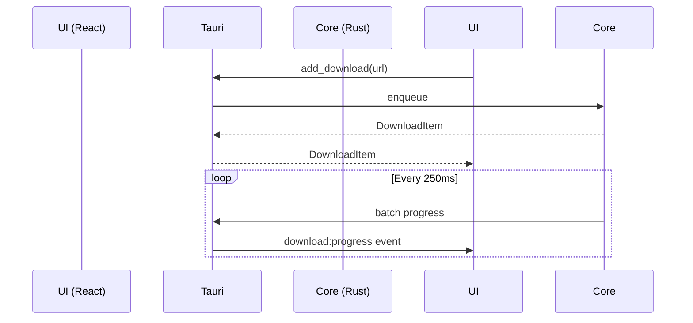
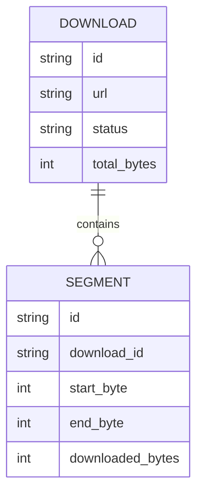

# Flux Architecture

Flux is a professional download manager built with a Rust core, a Tauri 2 shell, and a React + TypeScript UI. This document outlines the system architecture.

## 1. Rust Download Core & Module Boundaries

The core is implemented in Rust, maximizing performance and memory safety.
- `core/engine`: Manages the download lifecycles (start, pause, resume, cancel).
- `core/network`: Handles multi-connection HTTP requests using `reqwest`.
- `core/storage`: Manages writing files to disk (pre-allocation, segment writing).
- `core/db`: Handles SQLite operations for persistence using `sqlx`.
- `core/models`: Defines common data structures (DownloadItem, Segment, etc.).
- `core/queue`: Manages download queues and batch processing.

## 2. Tauri 2 Commands and Events

Tauri 2 acts as the bridge between the UI and the Rust core.

### Commands (UI -> Core)
- `add_download(url, options)`
- `pause(id)`
- `resume(id)`
- `cancel(id)`
- `get_settings()`
- `set_speed_limit(limit)`

### Events (Core -> UI)
- `download:progress`: Batched updates every 250ms containing speed, downloaded bytes, and segment progress.
- `download:status`: State changes (e.g., `downloading` -> `completed`).
- `download:detected`: Smart detection results for categorization.



## 3. React + TypeScript UI Structure

- **Framework**: React 19 + TypeScript + Vite.
- **State Management**: Zustand (for fast, selector-based re-renders).
- **Styling**: Tailwind v4 mapped to CSS Variables via Style Dictionary (5 themes).
- **Virtualization**: TanStack Virtual for high-performance rendering of download lists.

**Folder Structure (`ui/`)**:
- `src/theme/`: Theme provider and capability flags.
- `src/components/`: Reusable, theme-aware components.
- `src/screens/`: Main application views.
- `src/bridge/`: Tauri IPC wrappers.
- `src/store/`: Zustand stores.

## 4. SQLite Persistence Model

SQLite is used for all state persistence. 
- **`downloads` table**: ID, URL, filename, total bytes, category, status, path, timestamp.
- **`segments` table**: Download ID, start byte, end byte, downloaded bytes, status.
- **`queues` table**: Queue definition and concurrency limits.
- **`settings` table**: Global config (theme, paths, limits).



## 5. Multi-Connection Download Engine

The download engine divides a file into chunks (segments) based on server support (Accept-Ranges). Each segment is downloaded by a separate async task (Tokio). 
If a connection is slow, the engine can dynamically split another active segment to utilize bandwidth effectively.

## 6. Resume and Crash-Recovery Strategy

- The SQLite database is updated incrementally.
- Upon app start, any download left in `downloading` state is marked as `paused` or `interrupted`.
- Segments are tracked precisely. On resume, the engine reads the `segments` table and only requests the missing byte ranges via `Range: bytes=start-end` HTTP headers.
- File integrity is checked via checksums if provided by the server.

## 7. Browser Extension & Native Messaging

The extension connects to the Tauri backend using Native Messaging as the default transport, with a local WebSocket fallback on a fixed port if Native Messaging is unavailable.
- **Boundary**: The extension captures interceptable URLs and sends them to Flux. Strict origin checking, URL sanitization, and user consent prompts are enforced (see `EXTENSION_SECURITY.md`).
- **UI**: Uses a popup sharing the same UI token package as the main app.

## 8. Smart Series/Movie Detection

- Analyzes file names using regex patterns (and AI in the future).
- Extracts title, season, episode, and year.
- Categorizes the file and suggests structured save paths (e.g., `Downloads/Series/Title/Season X/Episode Y`).

## 9. Error Handling, Logging, & Security

- **Logging**: Rust uses `tracing` and logs to local rotating files. UI errors are captured via error boundaries.
- **Security**: Never log sensitive data (cookies, auth headers). Input URLs and paths are sanitized. Path traversal is prevented.
- **Secrets**: Encrypted storage for any proxy credentials or API tokens (via OS keychain where possible).

## 10. Testing Strategy & Initial Folder Structure

- **Core**: Rust unit tests for parsing, network logic, and DB migrations. Integration tests for download engine.
- **UI**: Storybook for component testing across all 5 themes. Playwright for visual regression.
- **Folder Structure**:
```
Flux/
├── core/            # Rust workspace
│   ├── Cargo.toml
│   └── src/
├── ui/              # React frontend
│   ├── package.json
│   └── src/
├── extension/       # Browser extension
├── docs/            # Architecture & PRDs
└── scripts/         # Dev scripts
```
